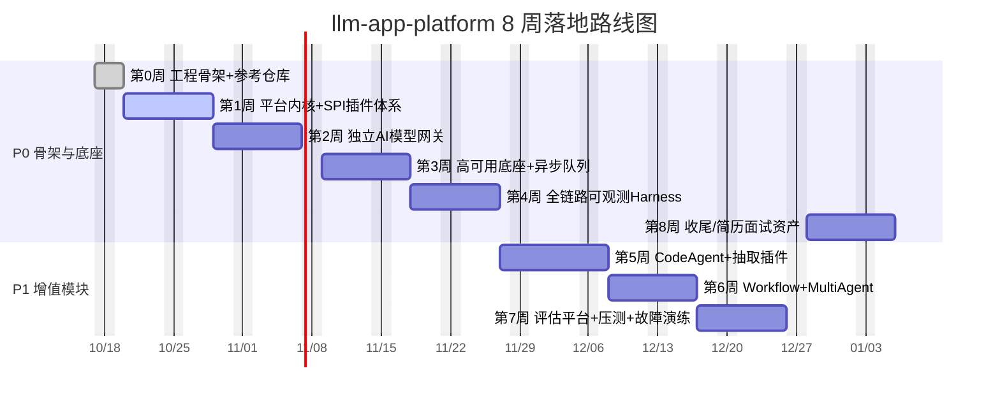

# llm-app-platform · 8 周落地 Roadmap

> 项目定位：自研**通用 LLM 应用运行平台**，RAG 仅作为可插拔插件之一。平台统一承载通用对话、RAG 问答、MCP 工具 Agent、CodeAgent、结构化抽取、多 Agent 编排、离线批量任务。
>
> 本文件是规划的单一事实来源（single source of truth），与根目录 `README.md` 第 0 周进度保持同步。状态图例：✅ 已完成 · 🔄 进行中 · ⬜ 未开始。

## 优先级定义

| 级别 | 含义 |
| --- | --- |
| **P0** | 必须做，项目骨架核心，简历核心亮点；不完成项目无法成立 |
| **P1** | 重要增值模块，面试强加分；P0 全部完成后再开发 |
| **P2** | 可选扩展；编码可选，面试仅口述架构，时间充足再落地 |

## 里程碑甘特图

> 时间轴按每周 7 个自然日估算（含周末），实际为工作日口径。第 8 周为收尾周，可与第 7 周评估资产并行。

## 详细路线图

### 第 0 周 · 开工前置（P0）✅ 已完成

**目标**：目录初始化、拉取 P0 参考仓库、搭建多模块工程骨架、配置 Cursor 上下文。

| 项 | 内容 |
| --- | --- |
| 核心任务 | 1) Gitee/GitHub 主仓库 + 多模块 SpringBoot 骨架；2) 本地目录结构；3) 克隆 P0 参考仓库到 `refs/`（ragent / damai-ai / ruoyi-ai / nexus-agent）；4) OrbStack 预拉容器镜像；5) Ollama 本地模型（qwen3:8b、bge-m3）；6) Open-WebUI 部署；7) Cursor 全局指令配置 |
| 参考仓库 | P0：ragent、damai-ai、ruoyi-ai、nexus-agent；补充：AssistantAgent / deepresearch / Lynxe / DataAgent / agentscope-examples（Spring AI Alibaba 生态，共 9 个） |
| 交付物 | ✅ 主仓库初始化；✅ refs 下 P0 参考仓库就绪（共 9 个，含 5 个补充）；✅ 多模块骨架编译+单测通过（初始提交 `c8deee8`）；✅ Cursor 上下文；✅ 观测栈 compose 编排文件生成 |
| 状态 | **已完成**（2026-10-17） |

---

### 第 1 周 · 平台内核 + SPI 插件架构 + 前置编排/三层执行器（P0）🔄 进行中

**目标**：确立平台/业务边界，落地自研插件化底座，让 RAG 作为第一个可插拔插件跑通。

| 项 | 内容 |
| --- | --- |
| 核心思想 | 取自 nexus-agent（Super-Agent）；MCP 抽象参考 ruoyi-ai + ragent |
| P0 任务 | 1) 多模块拆分 `platform-core`/`plugin-rag`；2) 统一插件 SPI 规范（生命周期、入参/出参、埋点钩子、元信息）；3) 插件注册中心（动态加载/卸载）；4) 集成验证：内核启动→加载 plugin-rag→文档入库/问答/MCP 调用；5) 架构 Mermaid + `docs/tradeoff.md` |
| P1 任务 | 编写基础单元测试 |
| 参考仓库 | nexus-agent、ruoyi-ai、ragent |
| 交付物 | 多模块平台内核 + SPI 插件体系 + plugin-rag；架构 Mermaid；tradeoff 决策文档 |
| 状态 | ⬜ 未开始（骨架已就绪，待深化 SPI 动态加载与三层执行器） |

---

### 第 2 周 · 独立 AI 模型网关微服务（P0）⬜ 未开始

**目标**：将模型调用从业务插件中彻底解耦，提供统一路由、降级、限流、流式能力。

| 项 | 内容 |
| --- | --- |
| 核心思想 | 网关逻辑参考 damai-ai；模型管理参考 ruoyi-ai |
| P0 任务 | 1) 新建 `gateway-service`：多模型路由（Ollama 本地 / 远端端点自动切换）；2) 健康探测、故障自动降级、超时控制、重试；3) 令牌桶限流（全局 + 按用户配额）；4) SSE 流式透传；5) 结构化日志 + OTEL 埋点；6) 端到端测试（请求→网关→core→rag，验证降级） |
| P1 任务 | 简易 API Key 鉴权 |
| 参考仓库 | damai-ai、ruoyi-ai |
| 交付物 | gateway-service 完整模块；网关降级测试用例；网关链路追踪验证 |
| 状态 | ⬜ 未开始 |

---

### 第 3 周 · 高可用底座改造 + 异步任务队列（P0）⬜ 未开始

**目标**：平台内核无状态化，引入异步削峰与故障隔离，支撑水平扩容。

| 项 | 内容 |
| --- | --- |
| P0 任务 | 1) core 无状态改造（任务/会话状态入 Redis）；2) RabbitMQ 异步任务队列（长耗时离线任务）；3) Resilience4j 熔断&舱壁隔离（按插件/任务类型）；4) Redis 多级缓存（Embedding、召回结果）；5) 本地多实例部署 + 网关负载均衡，验证水平扩容 |
| P1 任务 | 基础 Gatling 压测脚本（初版） |
| 参考仓库 | ruoyi-ai、nexus-agent |
| 交付物 | 无状态内核；异步任务队列；熔断规则；多实例扩容验证报告 |
| 状态 | ⬜ 未开始 |

---

### 第 4 周 · 全链路可观测 Harness（P0）⬜ 未开始

**目标**：落地项目核心加分亮点——统一埋点 + 观测栈 + 大盘，覆盖指标/日志/Trace。

| 项 | 内容 |
| --- | --- |
| 核心思想 | 埋点采用自研 OTEL 栈 + Spring AI 原生 Micrometer Observation；ruoyi/nexus 原生缺完整 OTEL 链路追踪 |
| P0 任务 | 1) OrbStack 一键观测栈（OTEL Collector + Prometheus + Loki + Grafana + AlertManager）；2) 全局 AOP 埋点切面（系统指标 JVM/容器/HTTP + LLM 指标 token/成功率/耗时/插件维度）；3) 3 套 Grafana 大盘（基础设施 / LLM 全局 / 插件业务）；4) 验证 RAG 任务 Trace+指标+日志完整展示 |
| P1 任务 | 基础告警规则（实例宕机、P95 延迟、全局错误率） |
| 参考仓库 | 自研 OTEL 栈（`compose/` 已生成） |
| 交付物 | 观测栈 compose；AOP 埋点切面；Grafana 大盘 JSON；验证截图 |
| 状态 | ⬜ 未开始（compose/ 编排文件已生成，待实际启动与埋点开发） |

---

### 第 5 周 · CodeAgent 插件 + 结构化抽取插件（P1）⬜ 未开始

**目标**：跳出 RAG，证明"通用插件平台"定位，扩展 MCP 工具与结构化输出能力。

| 项 | 内容 |
| --- | --- |
| 核心思想 | MCP 工具扩展参考 ruoyi-ai；结构化输出参考 langchain4j-examples |
| P1 任务 | 1) `plugin-code-agent`：MCP 文件读写、源码读取/分析/生成；2) `plugin-extractor`：文档结构化抽取，固定 JSON Schema 输出；3) 注册进插件中心，复用全局埋点，Grafana 按插件筛选；4) 测试：代码分析、PDF 合同字段抽取、全链路 Trace |
| P2 任务 | MCP 工具安全沙箱、命令黑名单 |
| 参考仓库 | ruoyi-ai、langchain4j-examples（P1 按需拉取） |
| 交付物 | plugin-code-agent + plugin-extractor；测试用例；多插件指标大盘 |
| 状态 | ⬜ 未开始 |

---

### 第 6 周 · Workflow 编排引擎 + MultiAgent 插件（P1）⬜ 未开始

**目标**：面试拔高亮点——轻量编排引擎 + 多 Agent 协作，含嵌套可观测。

| 项 | 内容 |
| --- | --- |
| 核心思想 | 编排底层参考 ruoyi-ai；任务规划/子 Agent 委托/证据预算参考 nexus-agent |
| P1 任务 | 1) core 内置轻量 Workflow 引擎（串行/并行/条件分支/重试/超时/Human-in-the-loop）；2) `plugin-multi-agent`：规划 Agent 拆解 + 委派子 Agent + 合并结果；3) 嵌套 Span 埋点，Grafana 展示子 Agent 调用树；4) 更新大盘新增工作流/多 Agent 面板 |
| P2 任务 | 工作流定义持久化存储 |
| 参考仓库 | ruoyi-ai、nexus-agent |
| 交付物 | Workflow 引擎；multi-agent 插件；嵌套 Trace 链路验证 |
| 状态 | ⬜ 未开始 |

---

### 第 7 周 · 统一评估平台 + 压测 Harness + 故障注入演练（P1）⬜ 未开始

**目标**：形成"评估→压测→演练→告警→复盘"的质量保障闭环。

| 项 | 内容 |
| --- | --- |
| 核心思想 | Badcase/幻觉/证据治理取自 nexus-agent |
| P1 任务 | 1) 平台级统一评估模块（全插件任务评估）：批量评测、完成率/抽取准确率/CodeAgent 正确率/RAG 召回；Badcase 管理后台（幻觉、工具失败、异常案例，人工标注）；2) 完整 Gatling 混合流量压测（RAG/CodeAgent/多 Agent 并发）；3) 故障注入演练逐条验证，写入 `docs/failure-handbook.md`（网关降级、MCP 不可用、队列堆积、子 Agent 死循环、IO 高负载、部分失败重试/熔断） |
| P2 任务 | 扩充 AlertManager 插件维度告警（CodeAgent 失败率、队列堆积） |
| 参考仓库 | nexus-agent |
| 交付物 | 批量评估脚本；Gatling 混合压测脚本；压测报告；《故障排查手册.md》 |
| 状态 | ⬜ 未开始 |

---

### 第 8 周 · 项目收尾 + 简历/面试资产（P0）⬜ 未开始

**目标**：安全加固，沉淀全部对外资产。

| 项 | 内容 |
| --- | --- |
| P0 任务 | 1) 安全加固：MCP 工具权限隔离（插件级工具白名单）、Prompt 注入防护；2) 项目文档（README、架构图、技术选型、trade-off、部署文档、一键启动、大盘截图）；3) 面试题库；4) 简历项目段落（量化、突出"插件化通用 LLM 平台"而非单纯 RAG）；5) Open-WebUI 导入文档+故障手册，构建面试官 Agent 模拟系统设计面试 |
| P1 任务 | 全链路回归测试（所有 P0/P1 模块） |
| 参考仓库 | — |
| 交付物 | 完整仓库；README；简历项目描述；面试题库；Open-WebUI 面试官 Agent |
| 状态 | ⬜ 未开始 |

---

## P2 可选扩展（时间富余，可编码实现，面试口述）

1. 多租户权限隔离插件
2. 文档异步导入、向量冷热数据分离
3. 钉钉告警通知通道

## 参考仓库清单与状态

> 各仓库的**学习优先级与逐周阅读路径**见 **[docs/reference-study-guide.md](docs/reference-study-guide.md)**。

| 仓库 | 优先级 | 地址 | 本地状态 |
| --- | --- | --- | --- |
| ragent | P0 | gitee.com/nageoffer/ragent | ✅ 已克隆 |
| damai-ai | P0 | gitee.com/java-up-up/damai-ai | ✅ 已克隆 |
| ruoyi-ai | P0 | gitee.com/ageerle/ruoyi-ai | ✅ 已克隆 |
| nexus-agent | P0 | gitee.com/gx729/nexus-agent | ✅ 已克隆 |
| langchain4j-examples | P1 | gitee.com/gx729/langchain4j-examples | ⬜ 待拉取（401 私有，需凭证） |
| springai-samples | P2 | gitee.com/gx729/springai-samples | ⬜ 待拉取（401 私有，需凭证） |

**补充参考（Spring AI Alibaba 生态，对应 Week5–7）** — 均为后续补充的本地解压副本（非 git 克隆），技术栈 Java17 / Spring Boot 3.x / Spring AI 1.x：

| 仓库 | 对应周次 | 定位 | 本地状态 |
| --- | --- | --- | --- |
| AssistantAgent-main | Week5 / Week7 | Code-as-Action（代码生成+GraalVM 沙箱）、评估图、动态 Prompt、经验/Skill 体系 | ✅ 已就位 |
| deepresearch-main | Week5 / Week6 | 基于 Spring AI Alibaba Graph 的 Multi-Agent 研究 Agent；Plan&Execute、Hybrid RAG、Reflection、HITL、自进化 Memory、安全沙箱 | ✅ 已就位 |
| Lynxe-main（原 JManus） | Week6 | 纯 Java 版 Manus，确定性探索任务、HTTP 服务调用、可嵌入 | ✅ 已就位 |
| DataAgent-main | Week5 | 企业级数据分析师：Text-to-SQL、Python 分析、智能报告、MCP Server | ✅ 已就位 |
| agentscope-examples | Week5 / Week6 | AgentScope Java 框架示例集（多 Agent / 工具调用 Demo） | ✅ 已就位 |

> `refs/` 全部 `.gitignore` 忽略，仅本地只读参考，不提交主仓库。

## 当前进度（截至 2026-10-22）

- ✅ 第 0 周完成：多模块骨架编译+单测通过、9 个参考仓库就绪（4 个 P0 克隆 + 5 个 Spring AI Alibaba 生态补充）、观测栈 compose 编排文件生成、README/Cursor 上下文就绪、已推送到 `github.com/WilSenwish/llm-app-platform`（main）。
- 🔄 第 1 周进行中：深化 SPI 动态加载（ServiceLoader）、plugin-rag 接向量库检索链路、补架构 Mermaid、写 `docs/tradeoff.md`。
- 📄 文档资产已补齐：`docs/ROADMAP.md`（详细路线图）、`docs/GITHUB_ABOUT.md`（GitHub 简介与 Topics）、`docs/reference-study-guide.md`（参考仓库学习优先级与逐周阅读路径）。
