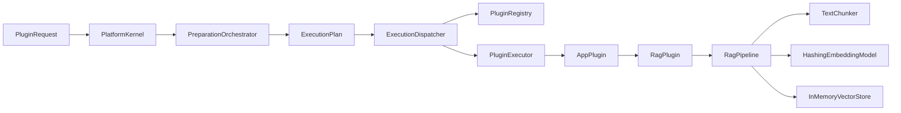
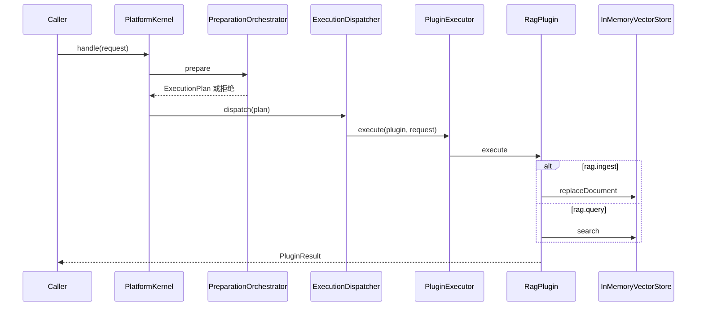

# 第 1 周：前置编排、三层执行器与 RAG 最小闭环

请求从 `PlatformKernel.handle` 进入，固定经过三层，再落到插件。RAG 是第一条走完这条链路的插件。

## 三层职责

| 层 | 类 | 做什么 | 不做什么 |
| --- | --- | --- | --- |
| 前置编排 | `PreparationOrchestrator` | 校验 traceId / userId / taskType / payload，按路由表选出插件 | 不加载插件，不执行业务 |
| 调度 | `ExecutionDispatcher` | 从注册中心取实例，组装本次 `PluginContext` | 不决定路由 |
| 执行 | `PluginExecutor` | 打开 `plugin.execute` Span，调用插件，把异常收成失败结果 | 不重试、不熔断 |

`taskType` 以 `rag.` 开头时路由到 `plugin-rag`。`payload.pluginId` 是保留键，显式指定时覆盖前缀。

## 插件怎么进来

1. Spring 容器里的 `AppPlugin` 先注册并 `init`。
2. `ServiceLoader` 再读 `META-INF/services/com.llmplatform.core.plugin.AppPlugin`。
3. 同一个插件 ID 已经存在则跳过 SPI 实例。避免两套内存向量库各记各的。

这是 classpath 发现，不是运行中热插拔一个新 jar。

## RAG 闭环

| 任务 | payload | 成功时 data |
| --- | --- | --- |
| `rag.ingest` | `docId`、`text` | `IngestResult` |
| `rag.query` | `query`，可选 `topK`（1–10，默认 3） | `QueryResult` |

文本按空行分段，超过 400 字再滑窗。向量是 1024 维字符二元组哈希，余弦低于 `0.25` 返回 `NO_EVIDENCE`，不拼接回答。回答把命中片段列出来，没有调用生成模型。

## 埋点

| Span | 低基数标签 |
| --- | --- |
| `orchestration.prepare` | 前缀路由时 `plugin.id`；显式指定时固定为 `explicit` |
| `orchestration.dispatch` | 已注册插件的 `plugin.id`；未注册时为 `unregistered` |
| `plugin.execute` | `plugin.id`、`plugin.type` |
| `rag.ingest` / `rag.retrieve` | `plugin.id=plugin-rag` |

调用方随意填写的插件 ID 只放高基数标签，避免把指标维度打爆。
