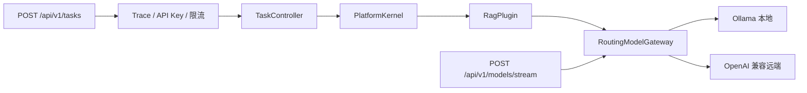
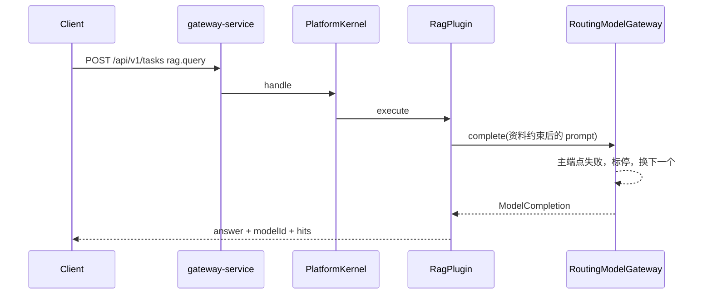

# 第 2 周：独立模型网关

HTTP 请求先进网关，再进内核和 RAG。RAG 需要生成时，回头调用同一个网关。端点切换发生在网关内部，插件看不到 Ollama 还是远端协议。

## 端点

| 方法 | 路径 | 作用 |
| --- | --- | --- |
| POST | `/api/v1/tasks` | 同步任务。`rag.ingest` / `rag.query` 走内核 |
| POST | `/api/v1/models/stream` | SSE。事件名 `delta`、`done` |
| GET | `/api/v1/models/health` | 探测端点并返回是否可用 |
| GET | `/api/v1/health` | 进程存活，不校验 API Key |

配额头是 `X-User-Id`，密钥头是 `X-Api-Key`。`llm.gateway.api-key` 为空时不鉴权。

## 路由规则

1. 配置里的 `endpoints` 按顺序就是优先级。
2. 同一端点最多尝试 3 次（含第一次），仍失败就标停。
3. 标停的端点跳过，直到 `GET /api/v1/models/health` 探测成功。
4. 单次调用超时默认 3 秒。
5. 流式在第一个 token 之前才会换端点。已经吐字之后失败就结束，避免两段答案拼在一起。

`provider: ollama` 调 `/api/chat`。`provider: openai` 调 `/v1/chat/completions`。本地和远端的差别是地址和协议，不是两套业务代码。

## 和 RAG 的边界

没有网关时，RAG 仍把命中片段拼起来。有网关时，先召回，相似度不够直接 `NO_EVIDENCE`，不会去问模型。召回成功后，把资料写进 prompt，用模型原文当回答，并带上实际应答的 `modelId`。模型全部不可用时返回 `MODEL_UNAVAILABLE`，不会退回拼接句冒充生成结果。

## 埋点

| Span | 标签 |
| --- | --- |
| `gateway.task` | 低基数 `task.family`（`rag` 或 `other`），高基数 `task.type` |
| `gateway.model.route` | 高基数 `trace.id` |
| `gateway.model.call` | 低基数 `model.id`、`model.attempt` |
| `gateway.ratelimit` | 仅拒绝时，低基数 `limit.result=rejected` |

日志带 `traceId`。请求体本身不打日志。
